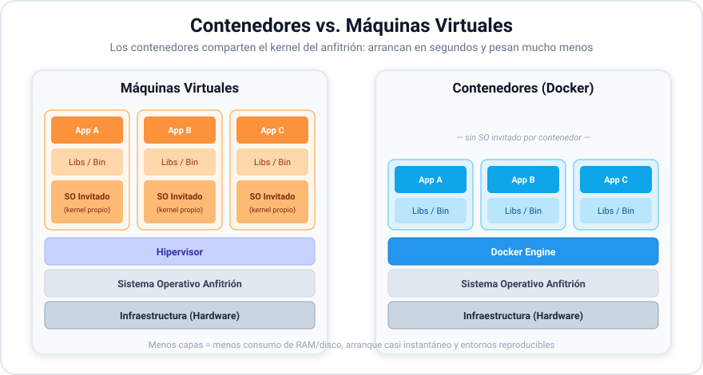
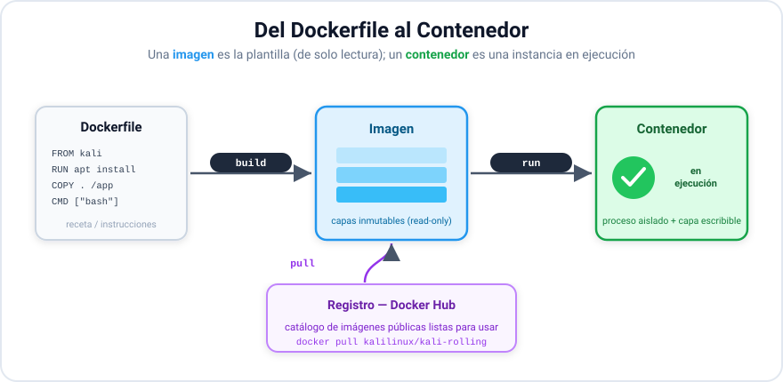
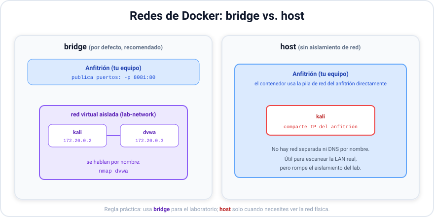
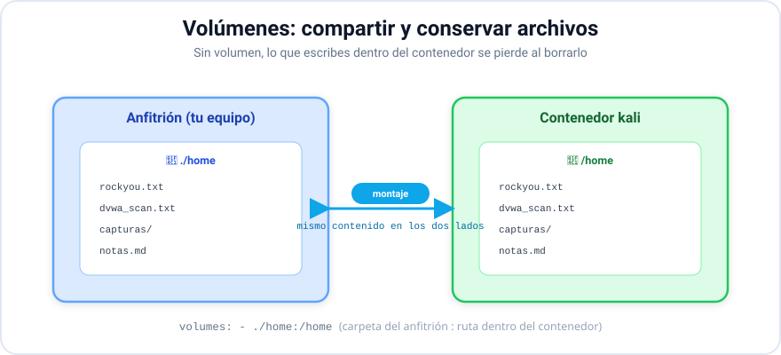
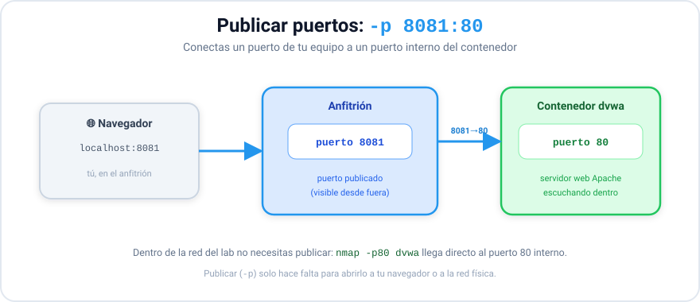
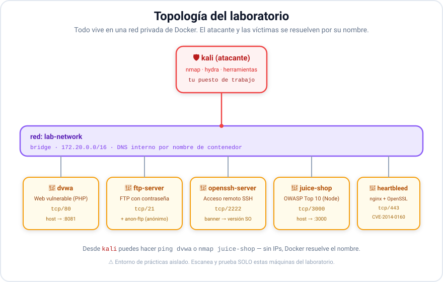
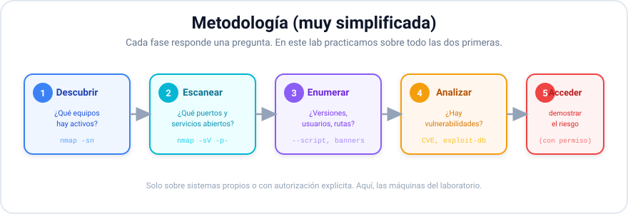
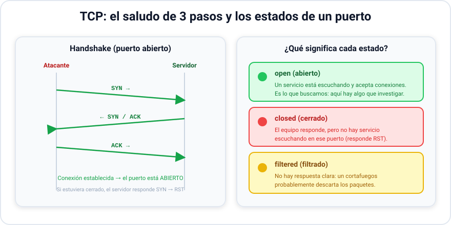

# 🐳 Laboratorio de Docker (con introducción a la seguridad)

<p align="center">
  
</p>

> **¿Qué es esto?** Un laboratorio para **aprender Docker** montando un pequeño entorno de red
> con varias máquinas. Como excusa práctica y muy motivadora, esas máquinas son
> *intencionadamente vulnerables*, así que de paso darás tus **primeros pasos con herramientas
> de seguridad** (nmap, hydra, sslscan…).
>
> El foco es **Docker**: imágenes, contenedores, redes, volúmenes y `docker compose`.
> La seguridad se mantiene **sencilla e introductoria**.

---

## 🎯 Qué vas a aprender

| Sobre Docker 🐳 | Sobre seguridad 🛡️ (introducción) |
|---|---|
| Diferencia entre imagen y contenedor | Metodología básica: descubrir → escanear → enumerar |
| Escribir un `Dockerfile` | Escaneo de red y de puertos con **nmap** |
| Orquestar varios servicios con `docker compose` | Detección de servicios y versiones |
| Redes de Docker (bridge vs host) y DNS por nombre | Por qué las **contraseñas débiles** son peligrosas (hydra) |
| Volúmenes para conservar y compartir archivos | FTP anónimo y exposición accidental de ficheros |
| Publicar puertos (`-p`) hacia el anfitrión | Identificar el SO por el *banner* de un servicio |
| Construir imágenes personalizadas | Qué es un **CVE** (ej.: Heartbleed) y cómo detectarlo |

---

## 🧭 Índice

- [⚖️ Aviso importante (uso ético y legal)](#️-aviso-importante-uso-ético-y-legal)
- [✅ Requisitos previos](#-requisitos-previos)
- [Parte 1 · 🐳 Conceptos de Docker](#parte-1--conceptos-de-docker)
  - [Contenedores vs. Máquinas Virtuales](#contenedores-vs-máquinas-virtuales)
  - [Imágenes, contenedores y Dockerfile](#imágenes-contenedores-y-dockerfile)
  - [docker compose: varios servicios a la vez](#docker-compose-varios-servicios-a-la-vez)
  - [Redes de Docker](#redes-de-docker)
  - [Volúmenes](#volúmenes)
  - [Publicar puertos](#publicar-puertos)
  - [Chuleta de comandos Docker](#-chuleta-de-comandos-docker)
- [Parte 2 · 🚀 Montar el laboratorio](#parte-2--montar-el-laboratorio)
  - [Estructura del proyecto](#estructura-del-proyecto)
  - [Levantar todo con un comando](#levantar-todo-con-un-comando)
  - [Topología del laboratorio](#topología-del-laboratorio)
  - [Entrar en la máquina atacante](#entrar-en-la-máquina-atacante)
  - [Comprobar la conectividad](#comprobar-la-conectividad)
- [Parte 3 · 🔍 Primeros pasos con herramientas de seguridad](#parte-3--primeros-pasos-con-herramientas-de-seguridad)
  - [Metodología en 5 fases](#metodología-en-5-fases)
  - [Nmap: descubrir, escanear y enumerar](#nmap-descubrir-escanear-y-enumerar)
- [Parte 4 · 🧪 Casos de uso por máquina](#parte-4--casos-de-uso-por-máquina)
  - [Caso A · DVWA — web vulnerable clásica](#caso-a--dvwa--web-vulnerable-clásica)
  - [Caso B · OWASP Juice Shop — web moderna](#caso-b--owasp-juice-shop--web-moderna)
  - [Caso C · FTP con contraseña + Hydra](#caso-c--ftp-con-contraseña--hydra)
  - [Caso D · FTP anónimo](#caso-d--ftp-anónimo)
  - [Caso E · SSH — fuerza bruta y huella del SO](#caso-e--ssh--fuerza-bruta-y-huella-del-so)
  - [Caso F · Heartbleed — un CVE famoso (avanzado)](#caso-f--heartbleed--un-cve-famoso-avanzado)
- [Parte 5 · 🏆 Retos propuestos](#parte-5--retos-propuestos)
- [🧹 Limpieza y problemas comunes](#-limpieza-y-problemas-comunes)
- [📚 Recursos](#-recursos)

---

## ⚖️ Aviso importante (uso ético y legal)

Este laboratorio es un **entorno cerrado y aislado** en tu propio equipo. Las máquinas víctima
son software diseñado *expresamente* para practicar (DVWA, Juice Shop, vulhub…).

> 🚨 **Escanear, atacar o "auditar" sistemas de terceros sin permiso explícito y por escrito es
> ilegal** en la mayoría de países. Las técnicas de este repositorio se practican **solo** contra
> las máquinas de este laboratorio. Úsalas para **aprender a defender**.

Para no exponer nada a tu red real, las máquinas vulnerables viven en una red privada de Docker y,
salvo las web (para que las veas en el navegador), **no publican puertos** hacia el exterior.

---

## ✅ Requisitos previos

1. **Docker Desktop** (Windows/macOS) o **Docker Engine + plugin compose** (Linux).
   - Comprueba que funciona:
     ```bash
     docker --version
     docker compose version
     ```
2. Unos **8 GB de RAM** libres recomendados (el laboratorio completo son 7 contenedores).
3. Conexión a Internet la primera vez (para descargar las imágenes).

> 💡 `docker compose` (con espacio) es la versión moderna del antiguo `docker-compose` (con guion).
> Si tu instalación solo tiene el guion, sustitúyelo en todos los comandos.

---

# Parte 1 · 🐳 Conceptos de Docker

## Contenedores vs. Máquinas Virtuales

Una **máquina virtual** emula un ordenador completo, con su propio sistema operativo. Un
**contenedor** empaqueta solo tu aplicación y lo que necesita, y **comparte el kernel** del sistema
anfitrión. Por eso un contenedor arranca en segundos y pesa megas en lugar de gigas.

<p align="center">
  
</p>

## Imágenes, contenedores y Dockerfile

Tres ideas que conviene no confundir:

- **Imagen**: la *plantilla* de solo lectura (el "molde"). Se construye a partir de un `Dockerfile`
  o se descarga de un **registro** como Docker Hub.
- **Contenedor**: una *instancia en ejecución* de una imagen (lo que de verdad corre). Puedes crear
  muchos contenedores a partir de la misma imagen.
- **Dockerfile**: el archivo de texto con la *receta* para construir una imagen.

<p align="center">
  
</p>

En este laboratorio construimos nuestra propia imagen de Kali con las herramientas preinstaladas.
Mira [`kali/Dockerfile`](./kali/Dockerfile): cada línea es un paso de la receta.

```dockerfile
FROM kalilinux/kali-rolling          # partimos de una imagen base
RUN apt-get update && apt-get install -y nmap hydra sslscan ...   # instalamos herramientas
WORKDIR /home                        # carpeta de trabajo por defecto
CMD ["bash"]                         # qué se ejecuta al arrancar el contenedor
```

## docker compose: varios servicios a la vez

Arrancar 7 contenedores a mano, con sus redes y volúmenes, sería tedioso y propenso a errores.
**`docker compose`** describe todo el entorno en un único archivo declarativo
([`docker-compose.yml`](./docker-compose.yml)) y lo levanta con un solo comando.

```yaml
services:
  kali:                    # nombre del servicio (y del contenedor en la red)
    build: ./kali          # construye la imagen desde nuestro Dockerfile
    tty: true
    networks: [lab-network]

  dvwa:
    image: vulnerables/web-dvwa   # usa una imagen ya publicada
    ports: ["8081:80"]            # publica el puerto 80 del contenedor en el 8081 del anfitrión
    networks: [lab-network]

networks:
  lab-network:             # una red privada que comparten todos
    driver: bridge
```

## Redes de Docker

Docker crea redes virtuales para que los contenedores se comuniquen. Las dos que te interesan:

- **`bridge`** (por defecto): red privada y aislada. Los contenedores de la misma red se ven
  entre sí **por su nombre** (Docker tiene un DNS interno). Es lo que usamos en el lab.
- **`host`**: el contenedor usa directamente la red del anfitrión (sin aislamiento). Útil solo si
  quieres escanear tu **red física real**, pero rompe el aislamiento del laboratorio.

<p align="center">
  
</p>

> 🔑 **Idea clave:** como todos comparten `lab-network`, desde Kali puedes hacer `nmap dvwa` o
> `ping openssh-server` **sin saber ninguna IP**. Docker resuelve el nombre por ti.

## Volúmenes

Lo que escribes *dentro* de un contenedor desaparece cuando lo borras. Un **volumen** conecta una
carpeta del anfitrión con una ruta del contenedor, de modo que los datos **persisten** y se
**comparten** en los dos sentidos.

<p align="center">
  
</p>

En el lab, `./home:/home` hace que tus capturas, diccionarios y resultados de escaneo queden
guardados en la carpeta [`home/`](./home) de tu equipo aunque recrees el contenedor.

## Publicar puertos

Por defecto, los puertos de un contenedor **no son accesibles** desde fuera de su red. Publicar un
puerto (`-p anfitrión:contenedor`, o `ports:` en compose) crea un "puente" hacia tu equipo.

<p align="center">
  
</p>

> Dentro de `lab-network` **no necesitas publicar nada**: `nmap -p80 dvwa` llega directo. Publicar
> solo hace falta para abrir un servicio a tu **navegador** o a la red física.

## 🧰 Chuleta de comandos Docker

| Acción | Comando |
|---|---|
| Levantar todo el lab en segundo plano | `docker compose up -d` |
| Levantar solo algunos servicios | `docker compose up -d kali dvwa` |
| Ver contenedores en marcha | `docker compose ps` |
| Entrar en un contenedor | `docker compose exec kali bash` |
| Ver logs de un servicio | `docker compose logs -f dvwa` |
| Parar todo (sin borrar) | `docker compose stop` |
| Parar y **eliminar** contenedores y red | `docker compose down` |
| Reconstruir la imagen de Kali | `docker compose build kali` |
| Listar imágenes descargadas | `docker images` |
| Ver la red y sus IPs | `docker network inspect security-lab-1_lab-network` |

---

# Parte 2 · 🚀 Montar el laboratorio

## Estructura del proyecto

```
security-lab-1/
├── docker-compose.yml        # define TODO el laboratorio
├── kali/
│   └── Dockerfile            # imagen de la máquina atacante con herramientas
├── home/                     # se monta como /home dentro de Kali (tus archivos)
├── targets/
│   └── anon-ftp/             # ficheros que sirve el FTP anónimo
├── assets/                   # diagramas SVG de este README
├── nmap-cheatsheet.md        # chuleta de nmap
└── readme.md                 # este archivo
```

## Levantar todo con un comando

Desde la raíz del proyecto:

```bash
docker compose up -d
```

La primera vez, Docker **descargará** las imágenes y **construirá** la de Kali (tarda unos minutos).
Comprueba que todo está arriba:

```bash
docker compose ps
```

Deberías ver `kali`, `dvwa`, `juice-shop`, `ftp-server`, `anon-ftp`, `openssh-server` y `heartbleed`.

> 💡 ¿Pocos recursos? Levanta solo lo que necesites para cada práctica, p. ej.
> `docker compose up -d kali ftp-server anon-ftp`.

## Topología del laboratorio

<p align="center">
  
</p>

## Entrar en la máquina atacante

```bash
docker compose exec kali bash
```

Estás dentro de Kali. Comprueba tu IP dentro de la red del lab:

```bash
ip a            # mira la interfaz eth0: será algo como 172.20.0.X
```

## Comprobar la conectividad

Antes de escanear nada, confirma que Kali "ve" a las demás máquinas **por su nombre**:

```bash
ping -c 2 dvwa
ping -c 2 openssh-server
```

Si responden, el DNS interno de Docker funciona y ya puedes empezar. 🎉

---

# Parte 3 · 🔍 Primeros pasos con herramientas de seguridad

## Metodología en 5 fases

Antes de lanzar comandos conviene saber **qué pregunta** responde cada paso. En este laboratorio
practicarás sobre todo las dos primeras fases (descubrir y escanear), que son la base de todo.

<p align="center">
  
</p>

## Nmap: descubrir, escanear y enumerar

**Nmap** es la navaja suiza para explorar una red: te dice qué equipos hay, qué puertos tienen
abiertos y qué servicios corren en ellos. Chuleta completa: [`nmap-cheatsheet.md`](./nmap-cheatsheet.md).

Para entender qué significan los resultados, recuerda cómo funciona una conexión TCP y qué estados
puede tener un puerto:

<p align="center">
  
</p>

**1) Descubrir hosts activos** (¿quién está encendido en mi subred?). Averigua primero tu subred
con `ip a` (p. ej. `172.20.0.0/16`) y haz un *ping sweep*:

```bash
nmap -sn 172.20.0.0/16
```

- `-sn`: solo descubrimiento de hosts, **sin** escanear puertos.

**2) Escanear puertos y servicios** de un host concreto (por nombre, gracias al DNS de Docker):

```bash
nmap -sV --open dvwa
```

- `-sV`: detecta el **servicio y su versión** en cada puerto abierto.
- `--open`: muestra solo los puertos abiertos (salida más limpia).
- Añade `-p-` para escanear **los 65535 puertos** (más lento) o `--top-ports 100` para los 100 más
  comunes (rápido).

**3) Enumerar con scripts (NSE).** Nmap trae cientos de scripts para sacar información extra:

```bash
nmap -sV -p80 --script "http-enum,http-title,http-headers" dvwa
```

> 💾 Guarda siempre la salida para analizarla con calma. Como `/home` es un volumen, el archivo
> aparecerá también en la carpeta `home/` de tu equipo:
> ```bash
> nmap -sV --open dvwa -oN /home/dvwa_scan.txt
> ```

---

# Parte 4 · 🧪 Casos de uso por máquina

Cada caso indica **qué aprendes de Docker** 🐳 y **qué aprendes de seguridad** 🛡️, con preguntas
para que investigues. No hay prisa: lo importante es *entender* cada paso.

---

## Caso A · DVWA — web vulnerable clásica

> 🐳 **Docker:** una web (Apache + PHP + MySQL) empaquetada en una imagen; publicamos su puerto 80
> en el 8081 del anfitrión. 🛡️ **Seguridad:** enumeración web y primer vistazo a credenciales por defecto.

1. Ábrela en tu navegador: **http://localhost:8081**
2. Desde Kali, enumera el servicio web:
   ```bash
   nmap -sV -p80 --script "http-enum,http-title" dvwa -oN /home/dvwa_scan.txt
   ```
3. Inicia sesión en DVWA (pista: usa las **credenciales por defecto** que encontrarás en su
   documentación) y pulsa *"Create / Reset Database"* para inicializarla.

**❓ Preguntas**
1. ¿Qué servicio y versión detecta nmap en el puerto 80?
2. ¿Qué rutas interesantes encuentra el script `http-enum`?
3. Busca esa versión en [CVE Details](https://www.cvedetails.com/) o
   [Exploit-DB](https://www.exploit-db.com/). ¿Tiene vulnerabilidades conocidas?
4. 📸 Sube una captura de DVWA funcionando y con la base de datos creada.

---

## Caso B · OWASP Juice Shop — web moderna

> 🐳 **Docker:** una SPA moderna en **Node.js** en una sola imagen; verás lo rápido que se despliega
> algo que "a mano" sería complejísimo. 🛡️ **Seguridad:** la web educativa de OWASP, llena de retos
> del **OWASP Top 10**.

1. Ábrela en: **http://localhost:3000**
2. Identifícala desde Kali:
   ```bash
   nmap -sV -p3000 juice-shop
   ```

**❓ Preguntas / retos**
1. ¿Qué *framework* y versión delata la cabecera del servidor?
2. Juice Shop esconde un "panel de puntuación" de retos. Encuéntralo explorando la web.
   (Pista: piensa en rutas típicas de administración… y en el *scoreboard*.)
3. Compara la experiencia con DVWA: ¿qué diferencias de estilo y tecnología notas?

---

## Caso C · FTP con contraseña + Hydra

> 🐳 **Docker:** un servicio sin interfaz gráfica, accesible **solo dentro de `lab-network`** (no
> publicamos su puerto). 🛡️ **Seguridad:** por qué una contraseña débil es un riesgo, usando un
> ataque de diccionario *contra nuestra propia máquina de prácticas*.

**1) Localiza el servicio FTP** (puerto 21):

```bash
nmap -sV -p21 ftp-server
```

**2) Prepara un diccionario de contraseñas** (el clásico `rockyou`):

```bash
cd /home
git clone https://github.com/zacheller/rockyou
mkdir -p /usr/share/wordlists
tar xC /usr/share/wordlists -f rockyou/rockyou.txt.tar.gz
```

**3) Ataque de diccionario con Hydra** *(solo contra `ftp-server` del lab)*:

```bash
hydra -l user -P /usr/share/wordlists/rockyou.txt ftp://ftp-server -t 4
```

- `-l user`: el usuario es conocido (minúscula = valor fijo; `-L fichero` probaría una lista).
- `-P ...`: la **lista** de contraseñas a probar (mayúscula = diccionario).
- `-t 4`: 4 intentos en paralelo.

> 🛡️ **La lección defensiva:** Hydra encuentra la contraseña porque es débil y está en un
> diccionario público. Contraseñas largas y únicas, limitar intentos y usar 2FA hacen que este
> ataque sea inviable. **Ese es el objetivo de la práctica: entender por qué defendernos así.**

**❓ Preguntas**
1. ¿Qué versión del servidor FTP reporta nmap?
2. ¿Cuánto tarda Hydra en encontrar la contraseña? ¿Por qué `rockyou` es tan "efectivo"?
3. Cambia `FTP_PASS` en `docker-compose.yml` por una contraseña larga y aleatoria, recrea el
   contenedor (`docker compose up -d ftp-server`) y repite. ¿Qué pasa ahora?

---

## Caso D · FTP anónimo

> 🐳 **Docker:** un volumen de **solo lectura** (`:ro`) expone ficheros del anfitrión al contenedor.
> 🛡️ **Seguridad:** el riesgo de dejar un FTP abierto a cualquiera.

Nmap tiene un script específico para detectar acceso anónimo:

```bash
nmap -p21 --script ftp-anon anon-ftp
```

Si ves `Anonymous FTP login allowed`, cualquiera puede entrar sin contraseña. Conéctate y mira qué
hay (los ficheros vienen de [`targets/anon-ftp/`](./targets/anon-ftp)):

```bash
ftp anon-ftp
# usuario: anonymous   (contraseña: vacía o cualquier email)
```

**❓ Preguntas**
1. ¿Qué fichero(s) encuentras? Léelos.
2. En un caso real, ¿qué tipo de información sensible podría acabar expuesta así por error?
3. Añade un fichero en `targets/anon-ftp/` en tu equipo. ¿Aparece dentro del FTP? (Esto demuestra
   cómo funciona el **volumen**.)

---

## Caso E · SSH — fuerza bruta y huella del SO

> 🐳 **Docker:** una imagen de `linuxserver` configurada con **variables de entorno** (usuario,
> contraseña, zona horaria). 🛡️ **Seguridad:** el *banner* de un servicio puede delatar el sistema
> operativo.

**1) Identifica el servicio y lee su banner** (escucha en el puerto 2222):

```bash
nmap -sV -p2222 openssh-server
```

**2) Conéctate** (el usuario es `sinfor`):

```bash
ssh sinfor@openssh-server -p 2222
```

**3) Ataque de diccionario** *(solo contra la máquina del lab)*:

```bash
hydra -l sinfor -P /usr/share/wordlists/rockyou.txt ssh://openssh-server -s 2222 -t 4
```

> ⚠️ SSH suele limitar conexiones en paralelo: usa pocos hilos (`-t 4`). Si vas con prisa en clase,
> empieza con un diccionario pequeño.

**4) Deduce el sistema operativo** a partir de la versión de OpenSSH. Por ejemplo, si el banner dice
`OpenSSH 8.2p1 Ubuntu 4ubuntu0.5`, puedes buscar esa versión en
[Launchpad](https://launchpad.net/ubuntu) para averiguar la versión y el *codename* de Ubuntu.

**❓ Preguntas**
1. ¿Qué versión de OpenSSH y qué sistema operativo deduces?
2. Otra pista del SO es el **TTL** de los paquetes (Linux ≈ 64, Windows ≈ 128). Haz `ping` y míralo.
   (Más detalle en la [chuleta de nmap](./nmap-cheatsheet.md).)
3. ¿Qué medidas evitarían el ataque de fuerza bruta en un SSH real (claves en vez de contraseña,
   `fail2ban`, cambiar el puerto…)? Razónalo.

---

## Caso F · Heartbleed — un CVE famoso (avanzado)

> 🐳 **Docker:** reproducir una vulnerabilidad histórica es tan fácil como levantar una imagen ya
> preparada. 🛡️ **Seguridad:** qué es un **CVE** y cómo se detecta con herramientas automáticas.

**Heartbleed** (CVE-2014-0160) fue un fallo en OpenSSL que permitía leer trozos de la memoria de un
servidor (claves, contraseñas…). La máquina `heartbleed` del lab lo reproduce en el puerto 443.

**1) Analiza su configuración TLS** con sslscan:

```bash
sslscan heartbleed
```

**2) Confírmalo con el script de nmap**:

```bash
nmap -p443 --script ssl-heartbleed heartbleed
```

Si el servidor es vulnerable, ambas herramientas lo indicarán claramente.

**❓ Preguntas**
1. ¿Qué protocolos TLS/SSL soporta el servidor? ¿Alguno está obsoleto?
2. ¿Por qué un fallo que "solo" lee memoria fue tan grave?
3. ¿Cómo se solucionó Heartbleed en su día? (Pista: actualizar OpenSSL **y** rotar las claves.)

---

# Parte 5 · 🏆 Retos propuestos

Pon a prueba lo aprendido. Sube tus respuestas y capturas.

**Nivel 1 — Docker**
- [ ] Levanta solo `kali`, `dvwa` y `juice-shop`. Demuéstralo con `docker compose ps`.
- [ ] Explica con tus palabras la diferencia entre `docker compose stop` y `docker compose down`.
- [ ] Añade una herramienta nueva a [`kali/Dockerfile`](./kali/Dockerfile), reconstruye la imagen y
      verifica que está disponible dentro del contenedor.

**Nivel 2 — Reconocimiento**
- [ ] Haz un *ping sweep* de `172.20.0.0/16` y lista **todas** las máquinas del lab con su IP.
- [ ] Para cada máquina, averigua sus puertos abiertos y el servicio/versión, y guarda cada escaneo
      en `/home` con `-oN`.
- [ ] Monta una tabla: máquina · IP · puertos · servicio · versión.

**Nivel 3 — Explotación guiada**
- [ ] Encuentra la contraseña del FTP y la del SSH con Hydra y documenta el tiempo que tardó cada uno.
- [ ] Confirma el acceso anónimo al FTP y recupera el fichero servido.
- [ ] Detecta Heartbleed y explica el CVE en 3 líneas.

**Nivel 4 — Pensar como quien defiende** 🛡️
- [ ] Elige **una** máquina y escribe 3 medidas concretas para que tu escaneo/ataque dejara de
      funcionar. Aplica una si puedes (p. ej. una contraseña fuerte) y vuelve a probar.

---

# 🧹 Limpieza y problemas comunes

**Apagar el laboratorio**
```bash
docker compose stop      # para los contenedores (los conserva)
docker compose down      # los elimina junto con la red (los datos de ./home se mantienen)
```

**Problemas frecuentes**

| Síntoma | Causa probable / solución |
|---|---|
| `port is already allocated` | El 8081 o el 3000 ya están ocupados. Cambia el lado izquierdo del `ports:` (p. ej. `8082:80`). |
| Kali no resuelve `dvwa` por nombre | ¿Está Kali en `lab-network`? ¿Arrancaste los servicios con el mismo `docker compose`? |
| `hydra: command not found` | Reconstruye la imagen: `docker compose build kali` y vuelve a entrar. |
| `locate` no encuentra scripts `.nse` | Ejecuta `sudo updatedb` dentro de Kali para actualizar la base de datos. |
| Imágenes muy pesadas / poca RAM | Levanta solo los servicios que necesites para la práctica. |
| Cambié el `Dockerfile` y no se aplica | `docker compose up -d --build kali` fuerza la reconstrucción. |

---

# 📚 Recursos

- 🧭 [Chuleta de nmap (en este repo)](./nmap-cheatsheet.md)
- 🐳 [Documentación oficial de Docker](https://docs.docker.com/)
- 🔍 [Documentación oficial de Nmap](https://nmap.org/book/man.html)
- 🧪 [DVWA](https://github.com/digininja/DVWA) · [OWASP Juice Shop](https://owasp.org/www-project-juice-shop/) · [vulhub](https://github.com/vulhub/vulhub)
- 🛡️ [OWASP Top 10](https://owasp.org/www-project-top-ten/) · [CVE Details](https://www.cvedetails.com/) · [Exploit-DB](https://www.exploit-db.com/)
- 🇪🇺 Versión en euskera del README: [`readme-eu.md`](./readme-eu.md) · Enumeración FTP/SSH/HTTP: [`Zerbitzu enumerazioa FTP, SSH.md/zerbitzu-enumerazioa.md`](./Zerbitzu%20enumerazioa%20FTP,%20SSH.md/zerbitzu-enumerazioa.md)

---

<p align="center"><sub>Laboratorio educativo · úsalo solo en entornos propios o con autorización · aprende a atacar para aprender a defender 🛡️</sub></p>
